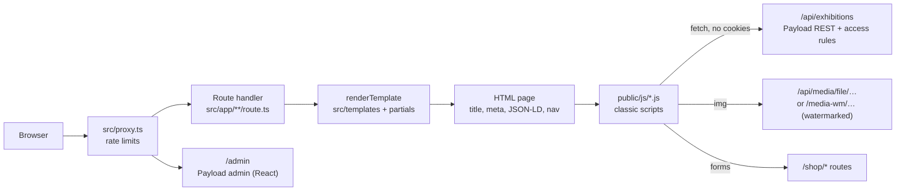
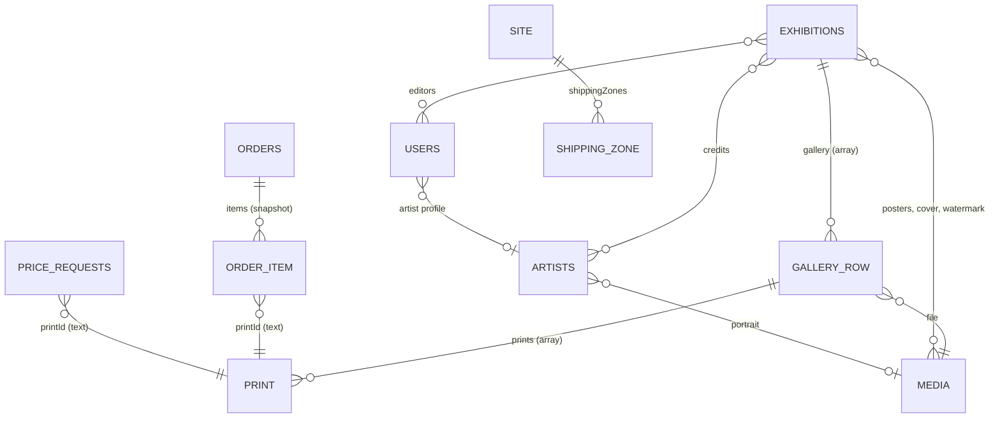
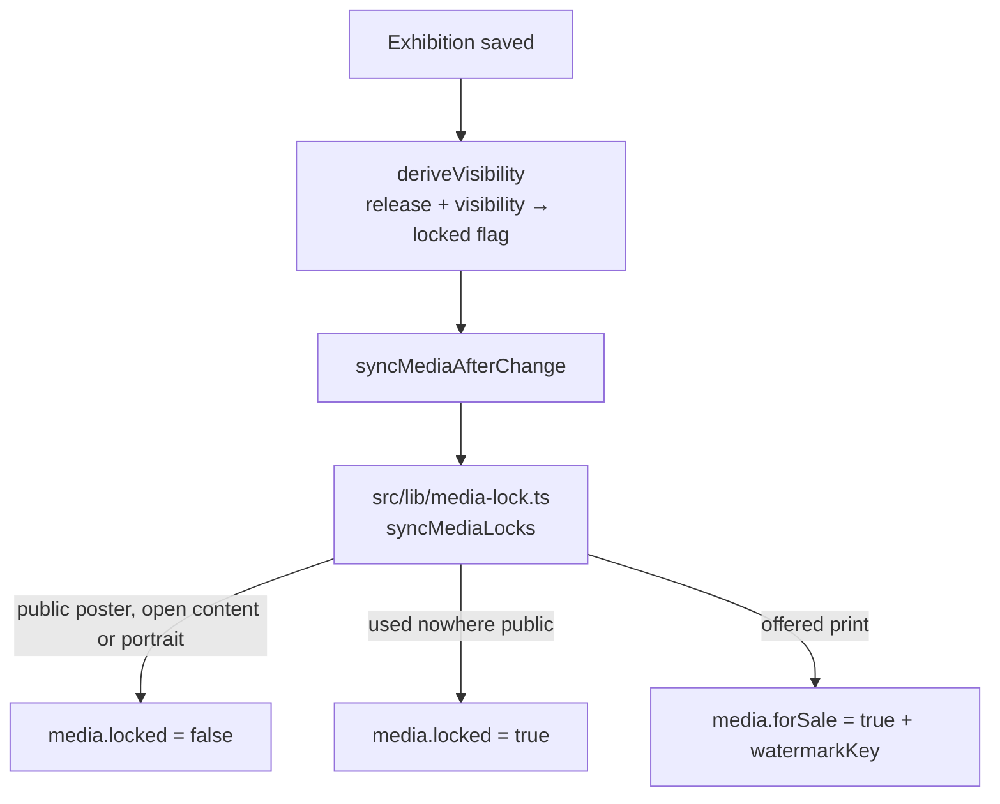
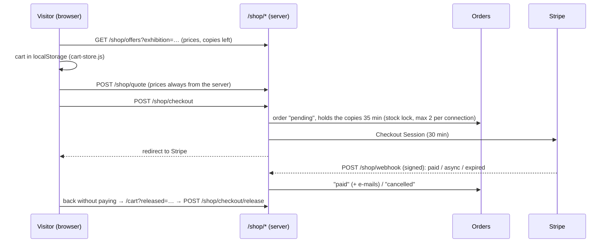

# Architecture

How Tripnjungle is built, for everyone who works on the code. Running and operating the site:
[README.md](README.md). How to work on it safely: [CONTRIBUTING.md](CONTRIBUTING.md).

## In one paragraph

One Next.js app (`cms/`) contains everything: **Payload CMS** (admin at `/admin`, REST API at `/api`,
SQLite database, uploads on disk) and the **public website**. The public pages are plain HTML templates
(`src/templates/`) that route handlers (`src/app/**/route.ts`) fill with meta data on the server; small
classic browser scripts (`public/js/`) then load the exhibitions from the Payload API and build
slideshows, galleries and the shop. There is no React on the public pages. Payments go through Stripe
Checkout, e-mails through SMTP. Production runs on Railway with one persistent volume for the database
and the media.

## Request flow



- **Every request** first passes `src/proxy.ts` (only POSTs to login, password and shop endpoints are
  counted; everything else passes straight through).
- **Pages**: a route handler loads what visitors may see (`findPublicExhibitions` – always as an
  anonymous visitor), renders the template with `renderTemplate` (`{{ }}` escaped, `{{{ }}}` raw HTML
  built by the server, `{{> head}}` / `{{> nav}}` / `{{> footer}}` / `{{> scripts}}` partials) and
  answers with a strict Content Security Policy (`htmlResponse`).
- **Data in the browser**: `public/js/data.js` calls `/api/exhibitions` **without cookies**, so the site
  looks the same for a logged-in admin and a visitor. Only the preview (`?preview`) sends the login.
- **Admin**: Payload's own React admin; its look on phones and desktops in `src/app/(payload)/custom.scss`, our additions are in `src/components/` (registered in
  `src/app/(payload)/admin/importMap.js`, generated with `npm run generate:importmap`).

## Data model



| Collection / global | File | What it holds |
| --- | --- | --- |
| Exhibitions | `src/collections/Exhibitions.ts` (+ `exhibitions/`) | title, dates, release, visibility, posters, cover, gallery rows with **prints** |
| Media | `src/collections/Media.ts` (+ `media/`) | uploads with three WebP sizes; `locked`, `forSale`, `watermarkKey` are set by the server |
| Artists | `src/collections/Artists.ts` | profile pages `/artist/<id>` |
| Accounts (users) | `src/collections/Users.ts` | roles, sections, contributor terms proof |
| Orders | `src/collections/Orders.ts` | snapshot of a purchase; created only by the server |
| Price requests | `src/collections/PriceRequests.ts` | "Request price" forms |
| Site settings | `src/globals/Site.ts` (+ `site/` one file per tab) | about, legal notice, privacy, shop, contributor terms, QR labels |

Prints are not a collection of their own: they live in the gallery row of the photo, so a print can
never point to a photo that is not in the exhibition. Orders keep a full **snapshot** (names, prices,
address), so later changes to an exhibition never change a sold order.

## Roles and access

All access decisions start in `src/access/roles.ts`.

| Role | May |
| --- | --- |
| admin | everything, also accounts, Site settings, deleting orders |
| manager | the sections given to the account: *Exhibitions* (all exhibitions, prints, prices, publishing) and/or *Shop* (orders, price requests) |
| artist | own profile and exhibitions crediting it; new exhibitions start in *planning* and *locked* |
| editor | content of the exhibitions listing the account as editor (not publishing, not prints) |

Field access (`access: { read, create, update }`) protects single fields; values only the server may
write use `serverOnly` / `hiddenServerOnly` from `src/fields/server-only.ts`. Visitors (no login) are
limited by the collection read access – e.g. Media: only `locked: false`, never the list `/api/media`.

## Visibility and the media lock



- **release**: *scheduled* (with date), *coming soon*, *planning* (invisible for visitors).
- **visibility**: *locked* (poster and details only), *locked with link* (content only at its own
  address; the address is not secret), *public*.
- A medium is public as soon as **any** exhibition (or artist portrait) makes it public; the state is
  recomputed from all exhibitions on every change (`syncMediaLocks`), so it can never drift.
- Artists and editors may only **add** media that are public already or their own uploads
  (`assertMediaMayBeAdded`) – otherwise they could publish somebody else's locked photo.

## Shop



- Code: `src/lib/shop/` – `catalog.ts` (offers from exhibitions), `checkout.ts` (quote, holds, Stripe),
  `stock.ts` (copies left = copies − holding orders), `hold.ts` (per-connection limit, release),
  `webhook.ts`, `emails.ts`, `legal.ts` (terms and withdrawal texts), `withdrawal.ts`, `settings.ts`
  (Site settings → shop, status checklist), `route.ts` (`shopPost`: origin + JSON checks).
- The browser only ever sends **which** print and how many; names, prices and stock come from the server.
- The shop opens only when it is switched on **and** Stripe, e-mail and a shipping zone are configured.

## Watermark

Photos with an offered print (`forSale`) are shown to visitors only as watermarked copies:
`watermarkedUrlsForVisitors` (Media `afterRead`) rewrites every URL to `/media-wm/<id>-<key>-<size>.webp`;
`src/app/media-wm/[file]/route.ts` makes the file on the first request with sharp
(`src/lib/watermark.ts`) and the plain files answer 404 to visitors. The key changes with the watermark
image and settings, so a change gives new file names. `watermarkSourceId` decides the image for the
key and for the file – one rule in one place.

## Browser scripts

Classic scripts sharing globals, loaded with `defer` in this order on every page
(`src/templates/partials/scripts.html`): `data.js` → `elements.js` → `consent.js` → `nav.js` →
`cart-store.js` → `shop.js`, then the page script (`script.js` home, `exhibition.js`, `photo.js`,
`events.js`, `exhibitions.js`, `cart.js`, `intro.js`, `withdrawal-form.js`) and the shared
`slideshow.js` / `viewer.js` where needed. Every file starts with **Needs / Provides**.

## Folder map

```
cms/
  src/
    access/roles.ts          roles, sections, access helpers
    app/                     route handlers: pages (/, /exhibition/…, /cart …), /shop/*, sitemap, robots
    app/(payload)/           Payload admin and REST API (generated)
    collections/             Exhibitions, Media, Artists, Users, Orders, PriceRequests (+ hooks/access)
    components/              admin React components (QR codes, shop status, contributor terms)
    endpoints/               custom Payload endpoints (QR, shop status, contributor terms)
    fields/                  shared field definitions
    globals/Site.ts, site/   Site settings, one file per tab
    lib/                     server logic (seo, page values, http helpers, media lock, watermark, shop/)
    migrations/              database migrations for production (generated)
    templates/, partials/    the HTML pages
    proxy.ts                 rate limits (Next.js proxy = middleware)
    payload.config.ts        Payload configuration
  public/                    css/, js/, favicon, OG image
  scripts/                   check-access.ts (+ access/), repair and maintenance scripts
```

## Where do I change what?

| I want to … | Look at |
| --- | --- |
| change a page's text or layout | `src/templates/<page>.html`, `public/css/style.css` |
| change header/footer/nav on all pages | `src/templates/partials/` |
| add a field to exhibitions | `src/collections/Exhibitions.ts`, then `npm run generate:types` and a migration |
| change who may do what | `src/access/roles.ts` and the `access` of the collection; add a check in `scripts/access/` |
| change the shop's prices, holds, e-mails | `src/lib/shop/` |
| change the legal texts' defaults | `src/lib/shop/legal.ts`, `src/lib/contributor-terms.ts`, `src/templates/imprint.html`, `privacy.html` |
| change SEO data (titles, JSON-LD, sitemap) | the page's route in `src/app/`, `src/lib/seo.ts`, `src/lib/page.ts` |
| change rate limits | `src/proxy.ts` |
| change the slideshow or the fullscreen view | `public/js/slideshow.js`, `public/js/viewer.js` |
